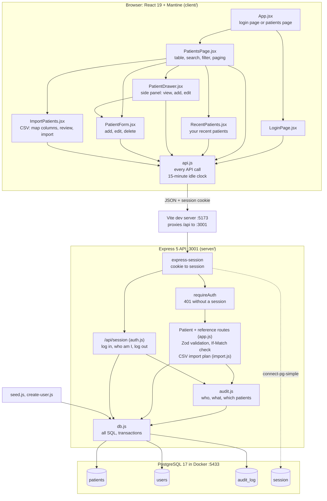

# Patient Tracker: Architecture

How the product decisions in [PRODUCT.md](PRODUCT.md) are built.
The guiding rule is **the simplest thing that's correct**: well-known
libraries, few moving parts, and code a new reader can follow.

## Overview



**One request, end to end:** saving an edited patient.
1. `PatientForm` calls `api('PUT', '/patients/42', …)` with an `If-Match`
   header holding the `updatedAt` it loaded.
2. Vite forwards `/api/*` to Express, so the browser sees one origin and
   sends the session cookie.
3. `express-session` loads the session from Postgres; `requireAuth` rejects
   the request with `401` if there isn't one (the browser then shows the
   login page).
4. The route checks `If-Match`, and Zod validates the body (`400` with
   per-field errors if it's invalid).
5. In one transaction, `db.js` updates the patient *only if* `updated_at`
   still matches, and `audit.js` records the update. If someone else saved
   first, nothing changes and the API returns `412`.
6. The updated patient goes back as JSON; `api.js` resets the idle clock and
   the list reloads.

## Stack

| Layer | Choice | Why |
| --- | --- | --- |
| Front end | **React 19** (Vite) | Widely known; fast dev server; almost no config. |
| UI components | **Mantine 9** | Every component we need (table, modal, searchable select, date input, notifications) from one library family. Its form library takes our API's dotted-path errors as-is. See [Why Mantine](#why-mantine). |
| Back end | **Express 5** | The smallest well-known Node HTTP framework. v5 forwards errors from async handlers automatically. |
| Database | **PostgreSQL 17** via `pg`, run with Docker Compose | Real `DATE` and list (`TEXT[]`) types; `unaccent` for accent-insensitive name search; `pg_trgm` indexes when we reach hospital scale. It's what production health systems run. |
| Sessions | **express-session** + **connect-pg-simple** | The standard Express session library, with sessions stored in our existing Postgres (no Redis). |
| Passwords | Node's built-in **scrypt** | A memory-hard password hash that ships with Node, so no extra dependency. |
| Validation | **Zod** | Declares each field rule once, and produces readable per-field error messages. |

## Layout

```
patient-tracker/
├── PRODUCT.md          product decisions and reasoning
├── ARCHITECTURE.md    this file
├── docker-compose.yml  local Postgres (host port 5433)
├── server/
│   ├── .env.example    DATABASE_OWNER_URL, DATABASE_URL, SESSION_SECRET; copy to .env
│   ├── audit.js        builds an audit entry from the request
│   ├── auth.js         password hashing, sessions, login/logout, requireAuth
│   ├── constants.js    status list (FHIR) and US state list
│   ├── create-user.js  admin script: create a provider account in a practice
│   ├── db.js           schema + every SQL query (routes contain no SQL)
│   ├── import.js       sorts CSV import rows: ready, already imported, duplicates, invalid
│   ├── index.js        starts the API (checks its database login, then listens)
│   ├── migrate.js      sets up the database as the owner (npm run migrate)
│   ├── app.js          Express routes + Zod validation; exported so tests can use it
│   ├── seed.js         demo logins + 5 edge-case patients + generated ones (Faker, fixed seed)
│   └── test/           node:test suites; integration ones use a throwaway database
└── client/             React front end
    ├── vite.config.js  proxies /api to Express (one origin, so cookies just work)
    └── src/
        ├── App.jsx           login page vs patients page; session-end messages
        ├── LoginPage.jsx
        ├── PatientsPage.jsx  table, debounced search, status filter, paging
        ├── PatientDrawer.jsx side panel: patient view, or the add/edit form; logs a read
        ├── PatientTable.jsx  patient table, shared by search results and recent patients
        ├── RecentPatients.jsx the provider's recent patients, before searching
        ├── PatientForm.jsx   add/edit form (shown in the side panel), delete confirmation
        ├── ImportPatients.jsx CSV import modal: choose file, map columns, review
        ├── csvImport.js      CSV row -> API patient; column-name guesses; date/ZIP/state fixes
        ├── api.js            every backend call; browser-side idle logoff
        └── format.js         name/date/age/"updated" display (no Date objects for DOBs)
```

## Data model: FHIR-shaped, not a FHIR server

The API's JSON uses FHIR's **field names and structure** (`name.given[]`,
`name.family`, `birthDate`, `address.line[]`, `postalCode`, and the
`EpisodeOfCare` status codes). That way anyone who knows FHIR can read it, and
it maps cleanly if we ever need to exchange data with an EHR.

We deliberately do **not** build a conformant FHIR server, which would mean
`resourceType`, a separate `EpisodeOfCare` resource, Bundles and search
parameters. That is a lot of machinery we don't need.

| FHIR | Ours | Simplification |
| --- | --- | --- |
| `Patient.name[]`, a list of HumanNames | one `name` + a `preferredName` string | Covers official + preferred, the only two uses we support. |
| `HumanName.prefix[]` / `suffix[]` (lists) | single strings | Patients rarely have more than one. |
| `EpisodeOfCare.status` (its own resource) | `status` directly on the patient | One episode per patient for now. |
| `Address.country`, `use`, `period` | omitted | US only (PRODUCT.md §3). |

Example patient:

```json
{
  "id": 2,
  "name": {
    "text": "Robert James Okafor Jr.",
    "prefix": "",
    "given": ["Robert", "James"],
    "family": "Okafor",
    "suffix": "Jr."
  },
  "preferredName": "Bobby",
  "birthDate": "1991-07-28",
  "status": "planned",
  "address": { "line": ["45 Elm Ave"], "city": "Austin", "state": "TX", "postalCode": "78701" },
  "createdAt": "2026-10-24T16:35:45.000Z",
  "updatedAt": "2026-10-24T16:35:45.000Z"
}
```

`name.text` (FHIR's display name) is **computed by the server** from the other
name parts. Clients never send it.

## Database

**Why Postgres over SQLite:** we started on SQLite (no setup at all). We
switched because three product decisions need what Postgres has built in:
- **Dates:** a real `DATE` type for birth dates.
- **Search on names from every culture:** SQLite's `LIKE` only ignores case
  for A–Z, so "josé" wouldn't find "JOSÉ". Postgres `ILIKE` with `unaccent`
  matches both, and also lets "jose" find "José".
- **Hospital scale:** a path to fast search over large tables via `pg_trgm`
  indexes.

The cost is that reviewers need Docker (`docker compose up -d`) or a local
Postgres install.

### Database logins

The server never connects as a superuser. There are two logins, from
`server/.env`:

| Login | Env var | Used by | Can |
| --- | --- | --- | --- |
| `postgres` (owner) | `DATABASE_OWNER_URL` | `npm run migrate` (and `npm run dev`, which runs it first), `seed.js`, `create-user.js`, the tests' setup | Everything: owns the tables. |
| `patient_tracker_app` | `DATABASE_URL` | The running API, for every request | `SELECT, INSERT, UPDATE` on `patients` (own practice only, by row-level security); `SELECT, INSERT` on `audit_log`; `SELECT` on `users`, `practices`; read/write `session`. Nothing else: no `DELETE` on patients, no changing or deleting audit entries, no creating accounts, tables or roles, no switching off row-level security. |

- **Why:** if the server were compromised (a stolen `.env`, an injection bug,
  a bad dependency), the attacker gets only the app login. They can't read
  other practices' patients, erase records, rewrite the audit log to hide
  what they did, or drop tables. This is HIPAA's least privilege (access
  management, §164.308(a)(4)) and protects the audit trail's integrity
  (§164.312(c)). Superusers can also run operating-system commands from
  SQL (`COPY … TO PROGRAM`), which the app login can't.
- **Row-level security applies to everything the server does,** because
  the app login neither is a superuser nor owns the tables. It doesn't
  depend on code remembering to switch roles.
- **`initDb` (as the owner) creates or updates the app login** from
  `DATABASE_URL`'s user name and password, then `REVOKE`s all and `GRANT`s
  exactly the rights above, so the rights in code are the rights in the
  database. It refuses to run if both URLs use the same login.
- **The server checks at startup** (`assertRestrictedLogin`) that its login
  isn't a superuser or the tables' owner, and refuses to start otherwise, so
  a misconfigured `.env` can't silently switch off row-level security.
- **Adding a table** means granting the app login access in `initDb`;
  forgetting fails loudly with "permission denied".
- **In production:** the server would get only `DATABASE_URL`, with the
  owner credentials kept for deploys and admin. Owner actions can be logged
  by Postgres itself (`pgaudit`). Hosted Postgres (AWS RDS, Cloud SQL) works
  this way already: there's no true superuser.
- **Still not protected:** anyone holding the owner credentials.

## Schema

[`db.js`](server/db.js) (`initDb`) is the source of truth; this section
explains it. **Update this section whenever the schema changes.**

```mermaid
erDiagram
    practices ||--o{ users : "employs"
    practices ||--o{ patients : "owns"
    users ||--o{ audit_log : "performs"
    patients }o--o{ audit_log : "appears in (patient_ids[])"

    practices {
        integer id PK
        text name UK
        timestamptz created_at
    }
    patients {
        integer id PK
        integer practice_id FK "row-level security
        text name_prefix
        text_array given_names
        text family_name
        text name_suffix
        text name_text "computed display name"
        text preferred_name
        date birth_date
        text status "CHECK: FHIR codes"
        text address_line1
        text address_line2
        text city
        text state
        text postal_code
        timestamptz created_at
        timestamptz updated_at
    }
    users {
        integer id PK
        integer practice_id FK
        text email UK "lowercased"
        text name
        text password_hash "scrypt salt:hash"
        timestamptz created_at
    }
    audit_log {
        bigint id PK
        timestamptz occurred_at
        integer practice_id FK
        integer user_id FK
        text action "CHECK: 8 actions"
        integer_array patient_ids
        text attempted_email
        text ip_address
    }
    session {
        varchar sid PK
        json sess "contains the logged-in user"
        timestamp expire
    }
```

### `practices`

A clinic or group using the app. Every provider and every patient belongs to
exactly one, and providers see only their own practice's patients.

| Column | Type | Constraints | Notes |
| --- | --- | --- | --- |
| `id` | `INTEGER` | PK, identity | |
| `name` | `TEXT` | not null, unique | Created by `create-user.js` or the seed. |
| `created_at` | `TIMESTAMPTZ` | not null, default `now()` | |

### `patients`

One row per patient. Columns are flat and `snake_case` (the Postgres
convention); the API converts them to nested, FHIR-shaped JSON.

| Column | Type | Constraints | Notes |
| --- | --- | --- | --- |
| `id` | `INTEGER` | PK, identity | Works like a medical record number, so it's PHI. |
| `practice_id` | `INTEGER` | not null, FK → `practices.id` | The practice the patient belongs to. Enforced by row-level security (see [Practice isolation](#practice-isolation)). |
| `name_prefix` | `TEXT` | not null, default `''` | FHIR `name.prefix` (Dr., Mx.). |
| `given_names` | `TEXT[]` | not null, default `{}` | FHIR `name.given`: first and middle names, in order. |
| `family_name` | `TEXT` | not null, default `''` | FHIR `name.family`. Empty for patients with only one name. |
| `name_suffix` | `TEXT` | not null, default `''` | FHIR `name.suffix` (Jr., III). |
| `name_text` | `TEXT` | not null | FHIR `name.text`: the full display name, **computed by the server** and stored so search can match it. |
| `preferred_name` | `TEXT` | not null, default `''` | FHIR name with `use = usual`. |
| `birth_date` | `DATE` | not null | Returned as `YYYY-MM-DD` text (see Conventions). |
| `status` | `TEXT` | not null, `CHECK` in FHIR codes | `planned`, `waitlist`, `active`, `onhold`, `finished`, `cancelled`, `entered-in-error`. |
| `address_line1` | `TEXT` | not null | Street. |
| `address_line2` | `TEXT` | not null, default `''` | Apt / unit. |
| `city` | `TEXT` | not null | |
| `state` | `TEXT` | not null | 2-letter code; the API checks it against the 59 US codes. |
| `postal_code` | `TEXT` | not null | Text, so leading zeros survive (`02110`). |
| `created_at`, `updated_at` | `TIMESTAMPTZ` | not null, default `now()` | `updated_at` is set on every edit and drives the list's sort order (index `patients_practice_updated_idx` on `practice_id, updated_at DESC, id DESC`). |

- **Status check in the database:** the API validates the status, and the
  `CHECK` constraint backs it up, so the database itself rejects anything
  else.
- **Rows are never deleted:** "delete" sets `status = 'entered-in-error'`.
- **The address is stored in full** as five columns, the way Epic's
  reporting database stores a patient's current address. A separate
  addresses table (multiple addresses, history) is on the Later list.

### `users`

Provider accounts, created by `create-user.js` (no sign-up).

| Column | Type | Constraints | Notes |
| --- | --- | --- | --- |
| `id` | `INTEGER` | PK, identity | |
| `practice_id` | `INTEGER` | not null, FK → `practices.id` | The only practice whose patients this provider sees. |
| `email` | `TEXT` | not null, unique | Stored lowercased, so login ignores case. |
| `name` | `TEXT` | not null | |
| `password_hash` | `TEXT` | not null | `salt:hash` from scrypt. Never returned by the API. |
| `created_at` | `TIMESTAMPTZ` | not null, default `now()` | |

### `audit_log`

Append-only record of patient access and logins (PRODUCT.md §7). Holds patient
ids, never names or search terms.

| Column | Type | Constraints | Notes |
| --- | --- | --- | --- |
| `id` | `BIGINT` | PK, identity | `BIGINT` because this table grows fastest. |
| `occurred_at` | `TIMESTAMPTZ` | not null, default `now()` | |
| `practice_id` | `INTEGER` | FK → `practices.id`, nullable | The provider's practice, so each practice's log can be reviewed on its own. Null only for a failed login with an unknown email. |
| `user_id` | `INTEGER` | FK → `users.id`, nullable | Null only for a failed login with an unknown email. |
| `action` | `TEXT` | not null, `CHECK` | `create`, `read`, `update`, `delete`, `query`, `login`, `login_failed`, `logout`. The `CHECK` is recreated from `AUDIT_ACTIONS` on every start, so an existing database accepts newly added actions. |
| `patient_ids` | `INTEGER[]` | not null, default `{}` | Every patient the action touched or showed. |
| `attempted_email` | `TEXT` | nullable | Failed logins only. |
| `ip_address` | `TEXT` | nullable | From the request. |

Index `audit_log_user_idx` on `(user_id, occurred_at)` serves recent patients,
which reads one provider's last 30 days.

- **No foreign key on `patient_ids`:** Postgres can't enforce foreign keys on
  items inside a list. This is safe because patient rows are never deleted,
  so the ids always stay valid.

### `session`

Used by **connect-pg-simple** (the session store). Its standard table is
created by `initDb`, because the app login can't create tables.

| Column | Type | Notes |
| --- | --- | --- |
| `sid` | `VARCHAR` PK | The session id held in the browser's cookie. |
| `sess` | `JSON` | Session data, including the logged-in user (`id`, `email`, `name`, `practiceId`, `practiceName`). |
| `expire` | `TIMESTAMP` | Indexed. Pushed 15 minutes ahead on every request (idle logoff). Expired rows are removed automatically. |

### Conventions

- **Translation:** `toPatient` / `toRow` in `db.js` convert between flat
  `snake_case` rows and the nested camelCase JSON. This is the only
  translation layer.
- **Dates:**
  - `birth_date` is a `DATE`. `pg` is told to return it as a plain
    `YYYY-MM-DD` string. Its default turns it into a JavaScript `Date` at
    local midnight, which can shift a birthday by a day across time zones.
  - We don't use Unix timestamps, for the same reason, and because they're
    negative for anyone born before 1970.
- **Sort order:** most recently updated first (`updated_at DESC, id DESC`),
  backed by the `patients_updated_at_idx` index so a page is read straight
  from the index. The seed spreads fake patients' `created_at`/`updated_at`
  over two years (edge cases: the last few hours, so they lead page 1).
- **No migrations tool.** Tables are created on startup if missing. While the
  schema is still changing in development, we reset with
  `docker compose down -v` and reseed.

## API

| Method | Path | Purpose |
| --- | --- | --- |
| POST | `/api/session` | Log in with `{ email, password }`. Returns the user and sets the session cookie. |
| GET | `/api/session` | The logged-in user, or `401`. The front end calls it on page load. |
| DELETE | `/api/session` | Log out. Returns `204`. |
| GET | `/api/reference` | Status list (with labels + descriptions) and US states for the form's dropdowns, so the client has no duplicate copy. |
| POST | `/api/patients/_search` | One page of matching patients, excluding entered-in-error. Body: `{ "search": "maria", "status": "active", "page": 1, "pageSize": 25 }`. Needs a `search` of at least 2 characters or a `status` (search-first); the rest are optional (`pageSize` max 100). Returns `{ patients, total, page, pageSize }`. A POST so patient details stay out of URLs (see below). |
| GET | `/api/patients/_recent` | Patients the logged-in provider opened (`read`), added or edited in the last 30 days, from their audit entries: the 10 most recently updated, newest first. Returns `{ patients }`; logged as a `query`. Declared before `/:id`. |
| GET | `/api/patients/:id` | One patient's full record, for the patient view. Logged as a `read` before responding. `404` if unknown or entered in error. |
| POST | `/api/patients` | Create. Returns `201` + patient. |
| PUT | `/api/patients/:id` | Replace. Returns the updated patient. Send `If-Match: "<updatedAt>"` (the value the editor loaded) to refuse the save if someone changed the patient since; the form always does. |
| DELETE | `/api/patients/:id` | Sets status to `entered-in-error` (no row is erased). Returns `204`. |
| POST | `/api/patients/_import` | CSV import. Body: `{ "patients": [ … ], "dryRun": true, "includeDuplicates": false }`, 1 to 5,000 patients shaped as `POST /api/patients` takes. Returns the plan `{ ready, alreadyImported, duplicates, invalid }` (row indexes; see below), plus `created` when `dryRun` is false. |

All routes except `/api/session` return `401` without a valid session.

**Errors**
- Validation failures return `400` with `{ "errors": { "<dotted.path>": "message" } }`,
  e.g. `"address.postalCode": "Use a 5-digit ZIP (or ZIP+4)"`. The form shows
  each message under the field with that path.
- Unknown or non-numeric ids return `404`, and so do patients entered in
  error: they can't be read, edited (which would bring them back) or deleted
  again.
- A `PUT` whose `If-Match` no longer matches the patient's `updatedAt`
  returns `412`. This is HTTP's (and FHIR's) optimistic locking: no lock is
  held while a form is open, and `updatedAt` serves as the version, compared
  to the millisecond, so no extra column is needed.
- Unexpected errors return `500` with a generic JSON message. The stack trace
  is logged; the request body never is, because it holds PHI.

**Search**
- **Search terms go in the request body, not the URL.** URLs are written to
  server, proxy and monitoring logs. Names and birth dates there would leak
  patient data. FHIR defines `POST [base]/Patient/_search` for the same
  reason, and we borrow its path.
- **Search-first:** a request without a `status` and without a `search` of
  at least 2 characters (after trimming) is a `400`, so the API can't be used
  to list every patient. A status alone is allowed: it's a worklist (e.g.
  the waitlist), and the audit entry still lists only the page returned.
- Search is done on the server. The query is split into words, and **every
  word** must appear in one of: the full name, the preferred name, or the
  birth date (ISO or MM/DD/YYYY).
- Matching ignores case and accents (`ILIKE` + `unaccent`): "jose munoz" finds
  *José Muñoz*.
- `%` and `_` are escaped so they match literally rather than as wildcards.
- **Paging:** `LIMIT`/`OFFSET` plus a separate `count(*)` for the total.
  - `id` is the last sort key, so the order is stable and no patient appears
    on two pages. Tested by walking all pages.
  - The audit entry lists only the patients on the returned page.

**CSV import** (PRODUCT.md §8)
- **The browser reads the file** (Papa Parse) and maps the provider's columns
  to fields (`csvImport.js`). The server receives ordinary FHIR-shaped
  patients and validates each with the same `patientSchema` as the form, so
  there is one set of rules.
- **Spreadsheet formats are fixed in the browser, before validation:**
  `3/12/1984` becomes `1984-03-12`; a 3- or 4-digit ZIP gets back the leading
  zeros a spreadsheet dropped; state names and status labels become codes.
  Anything else is sent as typed, and the server's message explains it.
- **Each row is sorted by `planImport` (`import.js`)**, comparing against
  current patients born on the rows' dates (`findPatientsBornOn`):
  - `invalid`: failed validation, with the usual `{ "<path>": "message" }` errors. Skipped.
  - `alreadyImported`: name, preferred name, birth date and address all
    match a patient on file, ignoring case and status. Skipped, so
    re-uploading a fixed file only adds the rows that were fixed.
  - `duplicates`: same first name, family name and birth date as a patient
    on file (`matchesIndex: null`) or an earlier row. Created only with
    `includeDuplicates: true`.
  - `ready`: everything else. Created.
- **Dry run, then import:** the front end sends the rows twice, first with
  `dryRun` for the review screen, then for real. The server keeps no state
  between the two and works out the plan again, so it's always current.
- **One transaction** creates every patient and a single `create` audit
  entry listing all their ids. The plan reveals which patients are already on
  file, so it's also logged as a `query` with the matched ids, like a search.
- **Body size:** `express.json` accepts up to 5 MB (about 2 MB for 5,000
  rows) instead of its 100 KB default.

## Authentication

- **Accounts:** the [`users`](#users) table. Each belongs to one practice.
  - Accounts are created with
    `npm run create-user -- <email> "<name>" "<practice>"`, which prints a
    random temporary password once. The practice is created if it doesn't
    exist yet, and the script says so, so a typo is noticed.
  - `npm run seed` also creates two demo logins in two practices:
    `demo@example.com` (Demo Practice) and `second@example.com` (Second Demo
    Practice), both with password `demo-password`.
- **Passwords:** hashed with `scrypt` and a random 16-byte salt, stored as
  `salt:hash`. They're checked with `timingSafeEqual`.
- **Login failures:**
  - A wrong email and a wrong password both return the same "Email or
    password is incorrect".
  - Both also take the same time: an unknown email is checked against a dummy
    hash. Otherwise, response time would reveal which emails have accounts.
- **Sessions:**
  - Stored in Postgres (the [`session`](#session) table). The browser only
    holds a cookie with the session id.
  - The session id is regenerated on login, which prevents session fixation
    (an attacker planting a known session id before the user logs in).
- **Cookie settings:**
  - `httpOnly`: page scripts can't read the cookie.
  - `sameSite: lax`: other sites can't make requests using it.
  - `secure` in production: sent only over HTTPS.
  - Signed with `SESSION_SECRET`.
- **Idle logoff:** `maxAge` is 15 minutes with `rolling: true`. Every request
  pushes the expiry back to 15 minutes from now, so the session ends after 15
  minutes of *inactivity*.
- **Who sees what:** any logged-in provider sees all patients (PRODUCT.md §7),
  so `requireAuth` only checks that someone is logged in.

## Practice isolation

Providers see only their own practice's patients (PRODUCT.md §7). Two
independent layers enforce it, so a bug in one doesn't leak patients:

1. **Every query filters by practice.** Every patient function in `db.js`
   takes a `db` from `withPractice(practiceId, work)` as its first argument,
   with no default, and adds `practice_id = db.practiceId` to its SQL. A
   query can't run without a practice scope by accident. Routes get that
   scope from `inPractice(req, …)`, which reads the practice from the
   **session**, set at login from the account. The request never supplies it.
2. **Postgres row-level security (RLS).** `withPractice` runs `work` in a
   transaction that first runs `set_config('app.practice_id', …, true)`.
   The `own_practice` policy on `patients` lets the app's login see and
   write only rows whose `practice_id` matches. The setting is local to the
   transaction, so it never leaks to the next request on the pooled
   connection.
   - **It applies because the server's login is restricted:** superusers
     and table owners bypass RLS, so the server connects as
     `patient_tracker_app`, which is neither (see
     [Database logins](#database-logins)). The same login also can't
     hard-delete patients or change or delete audit entries.
   - **Fails closed:** with no practice set, the policy matches nothing.

What's not scoped to a practice, on purpose: logging in (it must find the
account before knowing the practice), the session store, and the admin
scripts (which use the owner login).

**Results** for another practice's patient id are `404`, the same as an id
that doesn't exist, so they don't reveal that the patient exists. Import
duplicate checks and recent patients only look inside the practice too.

**Tested automatically** by `npm test` in `server/`
([`test/isolation.test.js`](server/test/isolation.test.js) and
[`test/api.test.js`](server/test/api.test.js); see README → Tests), as two
providers in two practices. Weakening the policy to `USING (true)` makes the
two database-only tests fail while the app-filter tests still pass, which
shows each layer is checked on its own.
- **Through the API:** reading, editing (with and without `If-Match`) and
  deleting the other practice's patient all return `404`. Searches and
  imports never match across practices.
- **Directly in Postgres, as the app's own login:**
  - a query with no `WHERE` clause returns only the current practice;
  - no practice set returns nothing;
  - inserting into or moving a patient to another practice is refused;
  - `DELETE` on `patients` and `UPDATE`/`DELETE` on `audit_log` are refused.

**Upgrading an existing database:** `initDb` adds the `practice_id` columns
and puts all existing patients and providers in a "Demo Practice". Sessions
from before have no practice, so `requireAuth` asks them to log in again.

## Audit log

The design comes from PRODUCT.md §7. In code:

- **Table:** see [Schema → `audit_log`](#audit_log).
- **Recording:** `audit(req, action, …)` in `audit.js` fills in the
  logged-in user and IP address from the request.
- **Writes are atomic:** each patient create/update/delete runs in
  `transaction()` together with its audit insert. If the audit insert fails,
  the patient change is rolled back too, so no change is ever saved without
  its audit record.
- **Imports:** one `create` entry listing every imported patient, in the
  same transaction as the inserts, plus a `query` entry for the patients on
  file that the rows matched.
- **Recent patients are read from it:** `listRecentPatients` takes the
  provider's `read`, `create` and `update` entries from the last 30 days,
  unnests their `patient_ids`, and returns those patients sorted by
  `updated_at`, as the Updated column shows. Showing
  the list writes a `query` entry, which doesn't feed back into it.
- **Opening a patient** writes a `read` entry before the record is sent,
  failing closed like a search.
- **Searches fail closed:** the `query` entry, with the ids of every patient
  in the results, is written *before* the response is sent. If it fails, the
  provider gets a 500 and no results.
- **Append-only:** the app has no code that updates or deletes audit rows.
  Enforcing this in the database itself (revoking `UPDATE`/`DELETE`) is on
  the Later list.
- **Reviewing it:** for now, with SQL. For example, "who has seen patient 42?":
  ```sql
  SELECT occurred_at, user_id, action FROM audit_log
  WHERE 42 = ANY(patient_ids) ORDER BY occurred_at;
  ```

## Front end

- **One origin:** in development, Vite proxies `/api` to Express, so the
  browser sees a single origin. The session cookie works with
  `sameSite: lax`, and no CORS setup is needed.
- **One place for API calls:** every request goes through `api()` in
  `api.js`.
  - A `401` (the server ended the session) clears the screen and shows the
    login page.
- **Idle logoff in the browser too:** `api.js` runs the same 15-minute clock
  as the server, reset on every request.
  - When it runs out, the patients page is removed from the screen, so no
    patient data and no unsaved form stays visible. The login page explains
    why.
  - Without it, the server would end the session but data would stay on
    screen until the next click.
- **Search:**
  - **Search-first:** until the box holds 2 characters or a status is
    chosen, the page shows a prompt and sends no request. Results are shown only while the box holds
    a long-enough search, so clearing it hides them at once instead of
    after the debounce. The search box has focus on load.
  - **Debounced** by 300 ms (`useDebouncedValue`), which also keeps the audit
    log to one entry per pause in typing, not per keystroke.
  - **Out-of-order safe:** each new search cancels the previous request
    (`AbortController`).
  - **No separate loading flag:** each result is stored with the query it
    answers, so "loading" is derived: the newest result is for an older
    query. The previous rows stay visible meanwhile.
- **Recent patients** (`RecentPatients.jsx`): shown under the search prompt
  only after the provider clicks **Show my recent patients**; typing a
  search, choosing a status or clicking Hide hides it again (a `showRecent`
  flag, cleared in those handlers rather than an effect). It fetches when
  shown and again after a save (the list's refresh counter). It uses the same `PatientTable` as the
  search results.
- **Side panel** (`PatientDrawer.jsx`): one Mantine `Drawer` for viewing,
  adding and editing. `PatientsPage` holds two pieces of state: `viewingId`
  (the patient shown) and `editing` (`undefined` = no form, `null` = adding,
  a patient = editing it). The panel shows the form whenever `editing` is
  set, and the patient's details otherwise.
  - **Fetched, not reused:** the list already holds each patient, but the
    panel calls `GET /api/patients/:id` so opening it is logged as a `read`.
    The fresh copy also carries the latest `updatedAt`, which **Edit** passes
    to the form for its conflict check.
  - **The panel owns the fetch,** not the details view, so switching to the
    form and back doesn't fetch again (or log another read).
  - **Closing:** from the edit form, Escape or the close button returns to
    the patient, like Cancel; otherwise it closes the panel. Click-outside is
    off while the form is open, and closing is off while saving. The panel
    owns that `submitting` flag and passes it to the form.
  - **After a save** the panel shows the saved patient (for a new one,
    `viewingId` becomes its id) and refreshes with the list's refresh
    counter. A delete closes it.
  - In development, React's StrictMode runs effects twice, so one open logs
    two reads (the first request is cancelled in the browser after the
    server has logged it). Production builds don't.
- **Add/edit form** (`PatientForm.jsx`, `@mantine/form`), rendered inside
  the side panel:
  - **Familiar fields, FHIR payload:** the form uses first/middle and
    street/unit fields; `toFormValues` / `toPayload` convert to and from the
    API's `name.given[]` and `address.line[]`. The first name stays whole
    ("Mary Ann"); middle names split on spaces. A blank first name is still
    sent in first place, and the API rejects a blank given name ahead of a
    filled one, so a middle name is never saved as the first.
  - **One set of validation rules:** the client doesn't validate. Server
    errors (`{ "address.postalCode": "…" }`) go straight into
    `form.setErrors`, with a small map for the few paths that differ
    (`name.given` → the first-name field). An error whose path matches no
    field is shown at the top of the form, so a failed save never looks
    like nothing happened.
  - **No autofill:** every field sets `autoComplete="off"` plus
    `data-1p-ignore` / `data-lpignore`, so the browser and password
    managers don't fill the *provider's* name or address into a patient
    record. 1Password did exactly that in testing before this was added.
  - **After a save or delete,** a refresh counter reloads the current page
    with the current filters. If the reloaded page comes back empty (a
    delete emptied the last page), the list moves to the new last page.
- **CSV import** (`ImportPatients.jsx`): a modal in three steps.
  - **Choose a file.** Papa Parse handles quoted commas and line breaks in
    cells. Every row keeps its spreadsheet row number (blank rows are
    dropped but still counted), so "Row 7" in the review matches the file.
  - **Map columns.** One dropdown per patient field, pre-selected when a
    header is a common name for it ("DOB", "Zip", "Last Name"), with the
    first row's value beside it. Review is disabled until every required
    field, including Status, has a column.
  - **Review.** The server's dry run is shown as counts and lists by row
    number, with a checkbox to include possible duplicates. Back returns to
    the mapping without re-reading the file.
- **Paging:** the page number is stored with the filters it was chosen for,
  so a new search or status filter goes back to page 1 without an extra
  effect or request.
- **Dates:** birth dates stay `YYYY-MM-DD` strings. Age and formatting use
  plain numbers, never `Date`, so time zones can't shift them.
  `updated_at` *is* a moment in time, so it's formatted with `Date` and the
  browser's built-in `Intl.RelativeTimeFormat` (no date library).

### Why Mantine

We compared Mantine, shadcn/ui (now on Base UI), MUI, React Aria Components,
Chakra UI, and plain CSS.
- **Mantine** gives the most finished UI for the least code we own.
- **Its form library fits our API:** it accepts errors keyed by paths like
  `address.city`, exactly the shape our API returns.
- **Accessibility:** WCAG 2.1 AA is a real requirement for healthcare
  organizations under HHS's 2024 Section 504 rule. Mantine follows the
  WAI-ARIA patterns, and we check keyboard navigation as part of testing.
- **Runner-up:** shadcn/ui, which would mean more copied code in the repo,
  plus Tailwind.

Planned scale work and future features are tracked in
[PRODUCT.md → Later](PRODUCT.md#later-post-mvp).

## Build order

1. ✅ **Backend**: schema, validation, REST API, seed data (tested with curl)
2. ✅ **Postgres**: switch from SQLite, Docker Compose setup
3. ✅ **Search out of URLs**: `POST /api/patients/_search`
4. ✅ **Login**: provider accounts (created by script), sessions, 15-minute idle logoff
5. ✅ **Audit log**: record who viewed, created, edited or deleted which patient
6. ✅ **Frontend**: login screen; patient table with debounced live search and status filter
7. ✅ **Frontend**: add/edit modal form (inline errors) and delete with confirmation
8. ✅ **CSV import**: map columns, review a dry run, import valid rows; re-imports skip rows already on file
