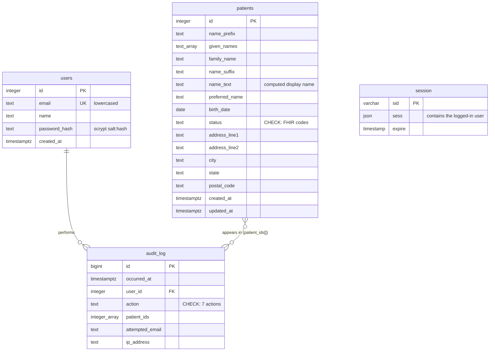

# Patient Tracker: Architecture

How the product decisions in [PRODUCT.md](PRODUCT.md) are built.
The guiding rule is **the simplest thing that's correct**: well-known
libraries, few moving parts, and code a new reader can follow.

## Stack

| Layer | Choice | Why |
| --- | --- | --- |
| Front end | **React 19** (Vite) | Widely known; fast dev server; almost no config. |
| UI components | **Mantine 9** | Every component we need (table, modal, searchable select, date input, notifications) from one library family. Its form library takes our API's dotted-path errors as-is. See [Why Mantine](#why-mantine). |
| Back end | **Express 5** | The smallest well-known Node HTTP framework. v5 forwards errors from async handlers automatically. |
| Database | **PostgreSQL 17** via `pg`, run with Docker Compose | Real `DATE` and list (`TEXT[]`) types; `unaccent` for accent-insensitive name search; `pg_trgm` indexes when we reach hospital scale. It's what production health systems run. |
| Sessions | **express-session** + **connect-pg-simple** | The standard Express session library, with sessions stored in our existing Postgres (no Redis). |
| Passwords | Node's built-in **scrypt** | A memory-hard password hash that ships with Node, so no extra dependency. |
| Validation | **Zod** | Declares each field rule once, and produces readable per-field error messages. |

## Layout

```
patient-tracker/
├── PRODUCT.md          product decisions and reasoning
├── ARCHITECTURE.md    this file
├── docker-compose.yml  local Postgres (host port 5433)
├── server/
│   ├── .env.example    DATABASE_URL, SESSION_SECRET; copy to .env
│   ├── audit.js        builds an audit entry from the request
│   ├── auth.js         password hashing, sessions, login/logout, requireAuth
│   ├── constants.js    status list (FHIR) and US state list
│   ├── create-user.js  admin script: create a provider account
│   ├── db.js           schema + every SQL query (routes contain no SQL)
│   ├── index.js        Express routes + Zod validation
│   └── seed.js         demo login + 5 edge-case patients + generated ones (Faker, fixed seed)
└── client/             React front end
    ├── vite.config.js  proxies /api to Express (one origin, so cookies just work)
    └── src/
        ├── App.jsx           login page vs patients page; session-end messages
        ├── LoginPage.jsx
        ├── PatientsPage.jsx  table, debounced search, status filter, paging
        ├── PatientForm.jsx   add/edit modal, delete confirmation
        ├── api.js            every backend call; browser-side idle logoff
        └── format.js         name/date/age/"updated" display (no Date objects for DOBs)
```

## Data model: FHIR-shaped, not a FHIR server

The API's JSON uses FHIR's **field names and structure** (`name.given[]`,
`name.family`, `birthDate`, `address.line[]`, `postalCode`, and the
`EpisodeOfCare` status codes). That way anyone who knows FHIR can read it, and
it maps cleanly if we ever need to exchange data with an EHR.

We deliberately do **not** build a conformant FHIR server, which would mean
`resourceType`, a separate `EpisodeOfCare` resource, Bundles and search
parameters. That is a lot of machinery we don't need.

| FHIR | Ours | Simplification |
| --- | --- | --- |
| `Patient.name[]`, a list of HumanNames | one `name` + a `preferredName` string | Covers official + preferred, the only two uses we support. |
| `HumanName.prefix[]` / `suffix[]` (lists) | single strings | Patients rarely have more than one. |
| `EpisodeOfCare.status` (its own resource) | `status` directly on the patient | One episode per patient for now. |
| `Address.country`, `use`, `period` | omitted | US only (PRODUCT.md §3). |

Example patient:

```json
{
  "id": 2,
  "name": {
    "text": "Robert James Okafor Jr.",
    "prefix": "",
    "given": ["Robert", "James"],
    "family": "Okafor",
    "suffix": "Jr."
  },
  "preferredName": "Bobby",
  "birthDate": "1991-07-28",
  "status": "planned",
  "address": { "line": ["45 Elm Ave"], "city": "Austin", "state": "TX", "postalCode": "78701" },
  "createdAt": "2026-10-24T16:35:45.000Z",
  "updatedAt": "2026-10-24T16:35:45.000Z"
}
```

`name.text` (FHIR's display name) is **computed by the server** from the other
name parts. Clients never send it.

## Database

**Why Postgres over SQLite:** we started on SQLite (no setup at all). We
switched because three product decisions need what Postgres has built in:
- **Dates:** a real `DATE` type for birth dates.
- **Search on names from every culture:** SQLite's `LIKE` only ignores case
  for A–Z, so "josé" wouldn't find "JOSÉ". Postgres `ILIKE` with `unaccent`
  matches both, and also lets "jose" find "José".
- **Hospital scale:** a path to fast search over large tables via `pg_trgm`
  indexes.

The cost is that reviewers need Docker (`docker compose up -d`) or a local
Postgres install.

## Schema

[`db.js`](server/db.js) (`initDb`) is the source of truth; this section
explains it. **Update this section whenever the schema changes.**



### `patients`

One row per patient. Columns are flat and `snake_case` (the Postgres
convention); the API converts them to nested, FHIR-shaped JSON.

| Column | Type | Constraints | Notes |
| --- | --- | --- | --- |
| `id` | `INTEGER` | PK, identity | Works like a medical record number, so it's PHI. |
| `name_prefix` | `TEXT` | not null, default `''` | FHIR `name.prefix` (Dr., Mx.). |
| `given_names` | `TEXT[]` | not null, default `{}` | FHIR `name.given`: first and middle names, in order. |
| `family_name` | `TEXT` | not null, default `''` | FHIR `name.family`. Empty for patients with only one name. |
| `name_suffix` | `TEXT` | not null, default `''` | FHIR `name.suffix` (Jr., III). |
| `name_text` | `TEXT` | not null | FHIR `name.text`: the full display name, **computed by the server** and stored so search can match it. |
| `preferred_name` | `TEXT` | not null, default `''` | FHIR name with `use = usual`. |
| `birth_date` | `DATE` | not null | Returned as `YYYY-MM-DD` text (see Conventions). |
| `status` | `TEXT` | not null, `CHECK` in FHIR codes | `planned`, `waitlist`, `active`, `onhold`, `finished`, `cancelled`, `entered-in-error`. |
| `address_line1` | `TEXT` | not null | Street. |
| `address_line2` | `TEXT` | not null, default `''` | Apt / unit. |
| `city` | `TEXT` | not null | |
| `state` | `TEXT` | not null | 2-letter code; the API checks it against the 59 US codes. |
| `postal_code` | `TEXT` | not null | Text, so leading zeros survive (`02110`). |
| `created_at`, `updated_at` | `TIMESTAMPTZ` | not null, default `now()` | `updated_at` is set on every edit and drives the list's sort order (indexed with `id`). |

- **Status check in the database:** the API validates the status, and the
  `CHECK` constraint backs it up, so the database itself rejects anything
  else.
- **Rows are never deleted:** "delete" sets `status = 'entered-in-error'`.
- **The address is stored in full** as five columns, the way Epic's
  reporting database stores a patient's current address. A separate
  addresses table (multiple addresses, history) is on the Later list.

### `users`

Provider accounts, created by `create-user.js` (no sign-up).

| Column | Type | Constraints | Notes |
| --- | --- | --- | --- |
| `id` | `INTEGER` | PK, identity | |
| `email` | `TEXT` | not null, unique | Stored lowercased, so login ignores case. |
| `name` | `TEXT` | not null | |
| `password_hash` | `TEXT` | not null | `salt:hash` from scrypt. Never returned by the API. |
| `created_at` | `TIMESTAMPTZ` | not null, default `now()` | |

### `audit_log`

Append-only record of patient access and logins (PRODUCT.md §7). Holds patient
ids, never names or search terms.

| Column | Type | Constraints | Notes |
| --- | --- | --- | --- |
| `id` | `BIGINT` | PK, identity | `BIGINT` because this table grows fastest. |
| `occurred_at` | `TIMESTAMPTZ` | not null, default `now()` | |
| `user_id` | `INTEGER` | FK → `users.id`, nullable | Null only for a failed login with an unknown email. |
| `action` | `TEXT` | not null, `CHECK` | `create`, `update`, `delete`, `query`, `login`, `login_failed`, `logout`. |
| `patient_ids` | `INTEGER[]` | not null, default `{}` | Every patient the action touched or showed. |
| `attempted_email` | `TEXT` | nullable | Failed logins only. |
| `ip_address` | `TEXT` | nullable | From the request. |

- **No foreign key on `patient_ids`:** Postgres can't enforce foreign keys on
  items inside a list. This is safe because patient rows are never deleted,
  so the ids always stay valid.

### `session`

Created and managed by **connect-pg-simple** (the session store), not by our
code. It's listed so the whole database is documented in one place.

| Column | Type | Notes |
| --- | --- | --- |
| `sid` | `VARCHAR` PK | The session id held in the browser's cookie. |
| `sess` | `JSON` | Session data, including the logged-in user (`id`, `email`, `name`). |
| `expire` | `TIMESTAMP` | Indexed. Pushed 15 minutes ahead on every request (idle logoff). Expired rows are removed automatically. |

### Conventions

- **Translation:** `toPatient` / `toRow` in `db.js` convert between flat
  `snake_case` rows and the nested camelCase JSON. This is the only
  translation layer.
- **Dates:**
  - `birth_date` is a `DATE`. `pg` is told to return it as a plain
    `YYYY-MM-DD` string. Its default turns it into a JavaScript `Date` at
    local midnight, which can shift a birthday by a day across time zones.
  - We don't use Unix timestamps, for the same reason, and because they're
    negative for anyone born before 1970.
- **Sort order:** most recently updated first (`updated_at DESC, id DESC`),
  backed by the `patients_updated_at_idx` index so a page is read straight
  from the index. The seed spreads fake patients' `created_at`/`updated_at`
  over two years (edge cases: the last few hours, so they lead page 1).
- **No migrations tool.** Tables are created on startup if missing. While the
  schema is still changing in development, we reset with
  `docker compose down -v` and reseed.

## API

| Method | Path | Purpose |
| --- | --- | --- |
| POST | `/api/session` | Log in with `{ email, password }`. Returns the user and sets the session cookie. |
| GET | `/api/session` | The logged-in user, or `401`. The front end calls it on page load. |
| DELETE | `/api/session` | Log out. Returns `204`. |
| GET | `/api/reference` | Status list (with labels + descriptions) and US states for the form's dropdowns, so the client has no duplicate copy. |
| POST | `/api/patients/_search` | One page of patients, excluding entered-in-error. Body (all optional): `{ "search": "maria", "status": "active", "page": 1, "pageSize": 25 }` (`pageSize` max 100). Returns `{ patients, total, page, pageSize }`. A POST so patient details stay out of URLs (see below). |
| POST | `/api/patients` | Create. Returns `201` + patient. |
| PUT | `/api/patients/:id` | Replace. Returns the updated patient. Send `If-Match: "<updatedAt>"` (the value the editor loaded) to refuse the save if someone changed the patient since; the form always does. |
| DELETE | `/api/patients/:id` | Sets status to `entered-in-error` (no row is erased). Returns `204`. |

All routes except `/api/session` return `401` without a valid session.

**Errors**
- Validation failures return `400` with `{ "errors": { "<dotted.path>": "message" } }`,
  e.g. `"address.postalCode": "Use a 5-digit ZIP (or ZIP+4)"`. The form shows
  each message under the field with that path.
- Unknown or non-numeric ids return `404`.
- A `PUT` whose `If-Match` no longer matches the patient's `updatedAt`
  returns `412`. This is HTTP's (and FHIR's) optimistic locking: no lock is
  held while a form is open, and `updatedAt` serves as the version, compared
  to the millisecond, so no extra column is needed.
- Unexpected errors return `500` with a generic JSON message. The stack trace
  is logged; the request body never is, because it holds PHI.

**Search**
- **Search terms go in the request body, not the URL.** URLs are written to
  server, proxy and monitoring logs. Names and birth dates there would leak
  patient data. FHIR defines `POST [base]/Patient/_search` for the same
  reason, and we borrow its path.
- Search is done on the server. The query is split into words, and **every
  word** must appear in one of: the full name, the preferred name, or the
  birth date (ISO or MM/DD/YYYY).
- Matching ignores case and accents (`ILIKE` + `unaccent`): "jose munoz" finds
  *José Muñoz*.
- `%` and `_` are escaped so they match literally rather than as wildcards.
- **Paging:** `LIMIT`/`OFFSET` plus a separate `count(*)` for the total.
  - `id` is the last sort key, so the order is stable and no patient appears
    on two pages. Tested by walking all pages.
  - The audit entry lists only the patients on the returned page.

## Authentication

- **Accounts:** the [`users`](#users) table.
  - Accounts are created with `npm run create-user -- <email> "<name>"`,
    which prints a random temporary password once.
  - `npm run seed` also creates the demo login `demo@example.com` /
    `demo-password`.
- **Passwords:** hashed with `scrypt` and a random 16-byte salt, stored as
  `salt:hash`. They're checked with `timingSafeEqual`.
- **Login failures:**
  - A wrong email and a wrong password both return the same "Email or
    password is incorrect".
  - Both also take the same time: an unknown email is checked against a dummy
    hash. Otherwise, response time would reveal which emails have accounts.
- **Sessions:**
  - Stored in Postgres (the [`session`](#session) table). The browser only
    holds a cookie with the session id.
  - The session id is regenerated on login, which prevents session fixation
    (an attacker planting a known session id before the user logs in).
- **Cookie settings:**
  - `httpOnly`: page scripts can't read the cookie.
  - `sameSite: lax`: other sites can't make requests using it.
  - `secure` in production: sent only over HTTPS.
  - Signed with `SESSION_SECRET`.
- **Idle logoff:** `maxAge` is 15 minutes with `rolling: true`. Every request
  pushes the expiry back to 15 minutes from now, so the session ends after 15
  minutes of *inactivity*.
- **Who sees what:** any logged-in provider sees all patients (PRODUCT.md §7),
  so `requireAuth` only checks that someone is logged in.

## Audit log

The design comes from PRODUCT.md §7. In code:

- **Table:** see [Schema → `audit_log`](#audit_log).
- **Recording:** `audit(req, action, …)` in `audit.js` fills in the
  logged-in user and IP address from the request.
- **Writes are atomic:** each patient create/update/delete runs in
  `transaction()` together with its audit insert. If the audit insert fails,
  the patient change is rolled back too, so no change is ever saved without
  its audit record.
- **Searches fail closed:** the `query` entry, with the ids of every patient
  in the results, is written *before* the response is sent. If it fails, the
  provider gets a 500 and no results.
- **Append-only:** the app has no code that updates or deletes audit rows.
  Enforcing this in the database itself (revoking `UPDATE`/`DELETE`) is on
  the Later list.
- **Reviewing it:** for now, with SQL. For example, "who has seen patient 42?":
  ```sql
  SELECT occurred_at, user_id, action FROM audit_log
  WHERE 42 = ANY(patient_ids) ORDER BY occurred_at;
  ```

## Front end

- **One origin:** in development, Vite proxies `/api` to Express, so the
  browser sees a single origin. The session cookie works with
  `sameSite: lax`, and no CORS setup is needed.
- **One place for API calls:** every request goes through `api()` in
  `api.js`.
  - A `401` (the server ended the session) clears the screen and shows the
    login page.
- **Idle logoff in the browser too:** `api.js` runs the same 15-minute clock
  as the server, reset on every request.
  - When it runs out, the patients page is removed from the screen, so no
    patient data and no unsaved form stays visible. The login page explains
    why.
  - Without it, the server would end the session but data would stay on
    screen until the next click.
- **Search:**
  - **Debounced** by 300 ms (`useDebouncedValue`), which also keeps the audit
    log to one entry per pause in typing, not per keystroke.
  - **Out-of-order safe:** each new search cancels the previous request
    (`AbortController`).
  - **No separate loading flag:** each result is stored with the query it
    answers, so "loading" is derived: the newest result is for an older
    query. The previous rows stay visible meanwhile.
- **Add/edit form** (`PatientForm.jsx`, `@mantine/form`):
  - **Familiar fields, FHIR payload:** the form uses first/middle and
    street/unit fields; `toFormValues` / `toPayload` convert to and from the
    API's `name.given[]` and `address.line[]`. The first name stays whole
    ("Mary Ann"); middle names split on spaces.
  - **One set of validation rules:** the client doesn't validate. Server
    errors (`{ "address.postalCode": "…" }`) go straight into
    `form.setErrors`, with a small map for the few paths that differ
    (`name.given` → the first-name field). An error whose path matches no
    field is shown at the top of the form, so a failed save never looks
    like nothing happened.
  - **No autofill:** every field sets `autoComplete="off"` plus
    `data-1p-ignore` / `data-lpignore`, so the browser and password
    managers don't fill the *provider's* name or address into a patient
    record. 1Password did exactly that in testing before this was added.
  - **After a save or delete,** a refresh counter reloads the list from page
    1, where the changed patient now appears (newest first).
- **Paging:** the page number is stored with the filters it was chosen for,
  so a new search or status filter goes back to page 1 without an extra
  effect or request.
- **Dates:** birth dates stay `YYYY-MM-DD` strings. Age and formatting use
  plain numbers, never `Date`, so time zones can't shift them.
  `updated_at` *is* a moment in time, so it's formatted with `Date` and the
  browser's built-in `Intl.RelativeTimeFormat` (no date library).

### Why Mantine

We compared Mantine, shadcn/ui (now on Base UI), MUI, React Aria Components,
Chakra UI, and plain CSS.
- **Mantine** gives the most finished UI for the least code we own.
- **Its form library fits our API:** it accepts errors keyed by paths like
  `address.city`, exactly the shape our API returns.
- **Accessibility:** WCAG 2.1 AA is a real requirement for healthcare
  organizations under HHS's 2024 Section 504 rule. Mantine follows the
  WAI-ARIA patterns, and we check keyboard navigation as part of testing.
- **Runner-up:** shadcn/ui, which would mean more copied code in the repo,
  plus Tailwind.

Planned scale work and future features are tracked in
[PRODUCT.md → Later](PRODUCT.md#later-post-mvp).

## Build order

1. ✅ **Backend**: schema, validation, REST API, seed data (tested with curl)
2. ✅ **Postgres**: switch from SQLite, Docker Compose setup
3. ✅ **Search out of URLs**: `POST /api/patients/_search`
4. ✅ **Login**: provider accounts (created by script), sessions, 15-minute idle logoff
5. ✅ **Audit log**: record who viewed, created, edited or deleted which patient
6. ✅ **Frontend**: login screen; patient table with debounced live search and status filter
7. ✅ **Frontend**: add/edit modal form (inline errors) and delete with confirmation
